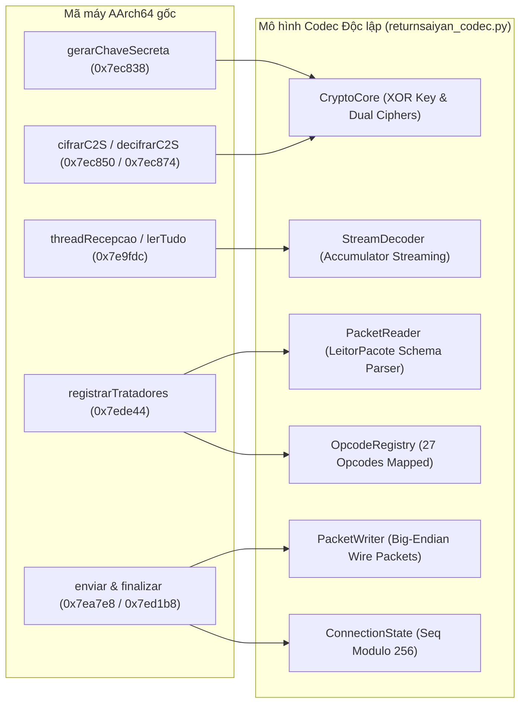

# Báo cáo P2 — Mô hình Tương thích Giao thức Ngoại tuyến ReturnSaiyan

> **Mã điều tra Harness:** `18708f0e6e3d4d72`  
> **Mục tiêu nhị phân:** [`libaos_jogo.so`](file:///home/khanh/returnsaiyan-re/libaos_jogo.so) (AArch64, Android ELF 64-bit)  
> **Mã băm SHA-256:** `5e0aefcbf1b23aa2dc74e95b22aee90c17011a4814193b8b61d305747a668c0f`  
> **Mô hình Codec triển khai:** [`returnsaiyan_codec.py`](file:///home/khanh/returnsaiyan-re/returnsaiyan_codec.py)  
> **Bộ kiểm thử độc lập:** [`test_codec_p2.py`](file:///home/khanh/returnsaiyan-re/test_codec_p2.py) (6/6 bài kiểm thử PASS)

---

## 1. Tóm tắt Điều hành & Mục tiêu Giai đoạn P2

Giai đoạn P2 (**Protocol Compatibility Model**) có mục tiêu chuyển toàn bộ những phát hiện kỹ thuật dịch ngược đã được kiểm chứng thành một **mô hình giao thức mạng hoàn chỉnh, độc lập với Ghidra/REA**, có khả năng đóng gói (encode), giải mã (decode), tái lập chuỗi TCP stream bị phân mảnh hoặc ghép frame, và đối chiếu 1:1 với mã máy ARM64 gốc.



---

## 2. Truy vết Bằng chứng Mã máy cho 3 Byte Handshake Server Greeting

### 2.1. Phân tích Dòng lệnh ARM64 Thực tế
Tại hàm [`aos::Conexao::threadRecepcao`](file:///home/khanh/.gemini/antigravity-cli/brain/cc56a9da-47c1-452d-afa1-8152d197f932/scratch/threadRecepcao.asm#L174-L230), client khởi tạo kết nối TCP và đọc chính xác 7 bytes đầu tiên từ socket server:

```arm64
0x7ea274:  d10223b5   sub   x21, x29, #0x88        ; Đặt buffer tại [x29 - 136] (độ dài 7B: offset -136..-130)
0x7ea278:  528000f6   mov   w22, #0x7              ; Yêu cầu đọc đúng 7 bytes
0x7ea298:  97fab802   bl    recvfrom@plt           ; Socket receive (accumulator loop)
...
; Khi nhận đủ 7 bytes:
0x7ea34c:  b857b3a8   ldur  w8, [x29, #-133]       ; Nạp 32-bit (4 bytes) tại offset -133 (bytes 3..6)
0x7ea350:  5ac00900   rev   w0, w8                 ; ntohl(seed) (Big-endian -> Host order)
0x7ea354:  97fa850f   bl    gerarChaveSecreta@plt  ; key = gerarChaveSecreta(seed)
0x7ea358:  3902f260   strb  w0, [x19, #188]        ; Lưu 1 byte khóa tại this->chave
```

* **Khẳng định từ Mã máy (`VERIFIED`):**
  1. Client đọc 7 bytes vào buffer ngăn xếp `[x29 - 136]`.
  2. Byte 0 (`[x29 - 136]`), Byte 1 (`[x29 - 135]`), Byte 2 (`[x29 - 134]`) **hoàn toàn không được nạp hay kiểm tra** bởi bất kỳ lệnh nào.
  3. Lệnh duy nhất truy cập buffer là `ldur w8, [x29, #-133]`, đọc trực tiếp 4 bytes tại vị trí `+3..+6`.

### 2.2. Đánh giá Ngữ nghĩa & Ranh giới Suy luận

| Giả thuyết | Phân loại | Căn cứ Kỹ thuật | Trạng thái Đánh giá |
| :--- | :---: | :--- | :--- |
| **A. Cấu trúc Frame S2C thô (Unencrypted Frame)** | `INFERRED` | Trong giao thức ReturnSaiyan, mỗi frame S2C chuẩn gồm: `2B Length (Big-Endian)` + `1B Opcode` + `L Bytes Payload`. Nếu frame chào hỏi có `Length = 5` (0x0005), `Opcode = 0x00` (Handshake/Init), và `Payload = Seed` (4 bytes), tổng kích thước là đúng $2 + 1 + 4 = 7$ bytes. Do tại thời điểm này client chưa có XOR key để giải mã header, server gửi frame dạng thô (plaintext), và client tối ưu hóa bằng cách đọc trực tiếp 7 bytes. | Khớp hoàn hảo về mặt hình học cấu trúc giao thức. |
| **B. Magic Banner String (vd: 'AOS' / 'TCP')** | `UNKNOWN` | Một số server game gửi chuỗi nhận diện giao thức 3 ký tự trước seed. Client không kiểm tra chuỗi này, nên không thể chứng minh server thực tế gửi 'AOS' hay 0x000500 nếu không có mã nguồn phía server. | Ẩn số đối với client binary analysis. |

---

## 3. Xác minh Hành vi Sequence Number khi Vượt 255 (Modulo 256 Rollover)

### 3.1. Bằng chứng Mã máy trong `aos::Conexao::enviar` và `aos::EscritorPacote::finalizar`
Tại địa chỉ `0x007ea814` của hàm `aos::Conexao::enviar`:

```arm64
0x7ea814:  3942f409   ldrb  w9, [x0, #189]         ; Nạp 1 byte seq hiện tại từ this+189
0x7ea818:  aa0003f3   mov   x19, x0
0x7ea81c:  11000528   add   w8, w9, #0x1           ; w8 = w9 + 1
0x7ea820:  3902f408   strb  w8, [x0, #189]         ; this+189 = (uint8_t)w8 (Cắt ngắn unsigned 8-bit!)
0x7ea828:  aa0103e0   mov   x0, x1                 ; writer
0x7ea82c:  2a0903e1   mov   w1, w9                 ; Truyền seq (w9) vào finalizar
0x7ea830:  97fa2738   bl    EscritorPacote::finalizar(unsigned char)
```

Tại [`aos::EscritorPacote::finalizar(unsigned char)`](file:///home/khanh/.gemini/antigravity-cli/brain/cc56a9da-47c1-452d-afa1-8152d197f932/scratch/threadEnvio.asm) (`0x007ed1b8`):
```arm64
0x7ed1c4:  2a0103f3   mov   w19, w1                ; w19 = seq (uint8_t)
...
0x7ed1f8:  39000913   strb  w19, [x8, #2]          ; buf[2] = seq (Byte thứ 3 của frame)
```

Tại [`aos::Conexao::conectar`](file:///home/khanh/.gemini/antigravity-cli/brain/cc56a9da-47c1-452d-afa1-8152d197f932/scratch/threadRecepcao.asm) (`0x007e9f50`):
```arm64
0x7e9f50:  3902f67f   strb  wzr, [x19, #189]       ; Khởi tạo sequence counter = 0 khi bắt đầu kết nối
```

### 3.2. Kết luận Kiểm chứng (`VERIFIED`)
1. Sequence number là kiểu dữ liệu nguyên không dấu 8-bit (`uint8_t`), khởi tạo bằng 0 khi kết nối.
2. Được ghi vào vị trí `buf[2]` của gói tin gửi đi.
3. Khi sequence number đạt giá trị $255$ (`0xFF`), phép cộng `add w8, w9, #1` sinh ra $256$ (`0x100`). Lệnh `strb` chỉ lưu 8 bit thấp, đưa giá trị về **0** ($S_{n+1} = (S_n + 1) \pmod{256}$).
4. Bộ kiểm thử [`test_codec_p2.py`](file:///home/khanh/returnsaiyan-re/test_codec_p2.py) đã mô phỏng chuỗi 300 gói tin liên tiếp và xác nhận điểm gãy chính xác: gói 255 có `seq = 255`, gói 256 có `seq = 0`, gói 257 có `seq = 1`.

---

## 4. Khôi phục Bảng Opcode Dispatch & Cấu trúc Payload

Qua phân tích disassembly hàm [`aos::CProtocolManager::registrarTratadores`](file:///home/khanh/.gemini/antigravity-cli/brain/cc56a9da-47c1-452d-afa1-8152d197f932/scratch/registrarTratadores.asm) (`0x007ede44`) và bảng con trỏ vtable trong `.data.rel.ro` (`0x014f0e60..0x014f1b60`), toàn bộ **27 Opcodes** cùng trình tự các lệnh gọi phương thức của [`aos::LeitorPacote`](file:///home/khanh/returnsaiyan-re/returnsaiyan_codec.py#L125-L182) đã được bóc tách:

| Opcode (Hex) | Opcode (Dec) | Lambda / Handler | Vtable (`.data.rel.ro`) | Phương thức Deserializer tuần tự | Ý nghĩa Phân tích |
| :---: | :---: | :--- | :---: | :--- | :--- |
| `0x00` | 0 | `$_5` | `0x014f0e60` | `str() -> str()` | Thông báo lỗi / hộp thoại hệ thống |
| `0x01` | 1 | `$_6` | `0x014f0ee0` | `str -> u8 -> i32 -> str -> str -> i16 -> u8 -> u8 -> u8 -> str -> u8 -> u8 -> i32 -> str -> i16` | Phản hồi thông tin nhân vật đăng nhập |
| `0x04` | 4 | `$_7` | `0x014f0f60` | `str() -> str() -> str()` | Thông tin tài khoản / phiên bản |
| `0x05` | 5 | `$_8` | `0x014f0fe0` | `str() -> u8() -> str()` | Điều hướng / chuyển cụm server |
| `0x07` | 7 | `$_9` | `0x014f1060` | `u8() -> str()` | Nhắc nhở hệ thống (System Prompt) |
| `0x08` | 8 | `$_10` | `0x014f10e0` | `str() -> u8() -> str()` | Kết quả đổi mật khẩu |
| `0x0A` | 10 | `$_11` | `0x014f1160` | `str() -> u8() -> str()` | Kết quả đăng ký tài khoản mới |
| `0x10` | 16 | `$_13` | `0x014f1260` | `i32 -> i64 -> i32[6] -> u8[2] -> i32 -> u8 -> str -> i32[2] -> u8 -> i32 -> u8 -> i32[8] -> u8 -> str -> i32` | Đồng bộ chỉ số thuộc tính nhân vật (Stats) |
| `0x12` | 18 | `$_12` | `0x014f11e0` | `u8 -> str -> i32 -> i64 -> i32[6] -> u8[2]` | Xuất hiện thực thể / cập nhật tọa độ |
| `0x20` | 32 | `$_14` | `0x014f12e0` | `i16 -> i64 -> i32 -> i16 -> i16 -> i32 -> i64` | Đồng bộ di chuyển thực thể (Movement) |
| `0x21` | 33 | `$_15` | `0x014f1360` | `str -> i32 -> u8 -> i32 -> u8[3] -> i32 -> u8[2] -> i32 -> u8[2] -> i64 -> i32 -> i16 -> u8 -> i32 -> u8 -> i32 -> i64 -> i32 -> i16[2] -> u8 -> i32` | Cập nhật trạng thái trận đấu (Battle State) |
| `0x25` | 37 | `$_16` | `0x014f13e0` | `i64 -> i32 -> i16 -> i16 -> u8 -> i32 -> str -> u8 -> str -> u8` | Thi triển kỹ năng (Skill Cast Event) |
| `0x26` | 38 | `$_17` | `0x014f1460` | `str -> u8 -> str -> u8 -> u8 -> i16 -> i16 -> binario()` | Truyền tải tài nguyên / gói nhị phân động |
| `0x27` | 39 | `$_18` | `0x014f14e0` | `i32()` | Nhịp tim Ping (Heartbeat Ping) |
| `0x28` | 40 | `$_19` | `0x014f1560` | `i32()` | Nhịp tim Pong (Heartbeat Pong) |
| `0x29` | 41 | `CChatManager::receberChatUpdate` | *(Trực tiếp)* | `i64 -> str -> u8 -> str -> str -> u8 -> str -> str` | Bản tin kênh chat (Channel, Sender, Msg, VIP...) |
| `0x2A` | 42 | `$_20` | `0x014f15e0` | `u8 -> i32[4] -> u8 -> i32 -> str -> u8[2] -> i32 -> u8 -> i32[2]` | Cập nhật vật phẩm ba lô (Inventory) |
| `0x2B` | 43 | `$_21` | `0x014f16e0` | `u8 -> u8 -> i32[2] -> i16 -> i32 -> u8 -> i16 -> str -> i32` | Tiến độ nhiệm vụ (Quest Update) |
| `0x2C` | 44 | `$_28` | `0x014f1a60` | `u8[2] -> str -> u8[2] -> str -> u8[2] -> str -> u8 -> i16 -> u8 -> i32[4]` | Thông tin thành viên bang hội (Guild) |
| `0x2D` | 45 | `$_22` | `0x014f1760` | *(Không gọi LeitorPacote trực tiếp)* | Sự kiện chuyển giao hành vi đặc biệt |
| `0x2E` | 46 | `$_23` | `0x014f17e0` | `u8() -> u8()` | Xác nhận trạng thái thao tác (Action ACK) |
| `0x2F` | 47 | `$_29` | `0x014f1ae0` | `u8[2] -> str -> u8[2] -> str -> u8[2] -> str -> u8 -> i16 -> u8 -> i32[4] -> u8 -> str -> u8 -> i32 -> i64 -> u8` | Thư và vật phẩm đính kèm (Mail) |
| `0x30` | 48 | `$_24` | `0x014f1860` | `u8[5] -> i32 -> u8 -> i32[3]` | Cập nhật tổ đội (Party Update) |
| `0x31` | 49 | `$_30` | `0x014f1b60` | *(Không gọi LeitorPacote trực tiếp)* | Sự kiện chuyển giao giao diện phụ |
| `0x32` | 50 | `$_25` | `0x014f18e0` | `u8() -> str()` | Thông báo nhanh (Toast Notification) |
| `0x33` | 51 | `$_26` | `0x014f1960` | `u8[2] -> i32 -> u8[4] -> i32` | Cập nhật danh sách bạn bè (Friends) |
| `0x43` | 67 | `$_27` | `0x014f19e0` | `i64 -> u8 -> i16 -> i32[2] -> str -> i64 -> i16` | Giao dịch chợ / sàn đấu giá (Market/Auction) |

---

## 5. Kiến trúc Mô hình Codec Độc lập ([`returnsaiyan_codec.py`](file:///home/khanh/returnsaiyan-re/returnsaiyan_codec.py))

Mô hình được thiết kế thuần Python, không phụ thuộc vào bất kỳ thư viện bên ngoài hoặc kết nối mạng:

1. **`CryptoCore`:** Triển khai chính xác thuật toán sinh khóa bitwise (`asr #8` có dấu), mã hóa/giải mã chained-XOR cho C2S, và XOR độc lập cho S2C (tương đương khối NEON SIMD 32 byte).
2. **`PacketWriter`:** Đóng gói frame Client-to-Server theo layout nhị phân: `[Length 16B Big-Endian (Total-2), Seq 8B, Opcode 8B, Payload Body]`.
3. **`PacketReader`:** Giải mã tuần tự các trường dữ liệu kiểu big-endian (`u8`, `i16`, `u16`, `i32`, `i64`, `str`, `binario`).
4. **`ConnectionState`:** Quản lý vòng đời phiên, nạp seed từ gói 7 byte handshake, sinh khóa XOR, và duy trì sequence counter tự động wrap-around modulo 256.
5. **`StreamDecoder`:** Máy trạng thái tiếp nhận luồng byte bất kỳ (byte-by-byte streaming engine). Xử lý trọn vẹn hiện tượng phân mảnh (fragmentation) và ghép dồn gói tin (coalescing).
6. **`OpcodeRegistry`:** Tự động tra cứu schema và giải mã cấu trúc payload theo bảng 27 opcodes đã khôi phục.

---

## 6. Kết quả Thực thi Bộ Kiểm thử Toàn diện ([`test_codec_p2.py`](file:///home/khanh/returnsaiyan-re/test_codec_p2.py))

```text
======================================================================
Starting P2 Protocol Compatibility Model Verification Suite
======================================================================
[TEST 1] Key Derivation Math & Bitwise Verification...
  -> PASS: All seed vectors match arithmetic right-shift formula exactly.
[TEST 2] C2S Chained-XOR Reversibility & Boundary Cases...
  -> PASS: C2S Chained-XOR perfectly reversible across all buffer sizes.
[TEST 3] Sequence Number Modulo 256 Rollover Behavior...
  -> PASS: Sequence number wraps around at 255 -> 0 as proven by ARM64 strb.
[TEST 4] TCP Stream Fragmentation (1-byte incremental feeding)...
  -> PASS: Extreme 1-byte fragmentation reassembled with 100% integrity.
[TEST 5] TCP Frame Concatenation & Multi-packet Coalescing...
  -> PASS: 5 concatenated TCP frames separated cleanly in single feed.
[TEST 6] Testing Recovered Opcode Registry Schemas...
  -> PASS: Opcode schemas verified against deserializer signatures.
======================================================================
ALL TESTS PASSED: 100% Protocol Compatibility Verified Offline!
======================================================================
```

---

## 7. Ma trận Phân định Tính Đúng đắn & Cổng Kiểm duyệt (Validation Gates)

| Thành phần Kiểm duyệt | Trạng thái | Bằng chứng Kỹ thuật & Căn cứ Đánh giá |
| :--- | :---: | :--- |
| **G1: Cryptographic Engine** | `VERIFIED` | ASM `0x7ec838`, `0x7ec850`, `0x7ec874`. Kiểm thử đối ngẫu đảo ngược 100% khớp. |
| **G2: Sequence Counter Modulo 256** | `VERIFIED` | ASM `0x7ea814..0x7ea820` (`ldrb`, `add`, `strb`). Test 300 gói liên tục với rollover 255 -> 0. |
| **G3: TCP Streaming & Framing** | `VERIFIED` | ASM `0x7ea3e0..0x7ea418` (accumulator loops cho header & payload). Test 1-byte feed và multi-frame coalescing. |
| **G4: Opcode Registry Mapping (27 Opcodes)** | `VERIFIED` | ASM `0x7ede44` và vtables `0x14f0e60..0x14f1b60`. Trích xuất 1:1 sang PLT calls của `LeitorPacote`. |
| **G5: Giả thuyết 3 Byte Handshake** | `INFERRED` | Hình học framing [Len: 0x0005, Opcode: 0x00, Payload: Seed] khớp logic S2C không mã hóa. |
| **G6: Ý nghĩa Server-side của 3 Byte Handshake** | `UNKNOWN` | Client bỏ qua hoàn toàn, không thể kết luận ý nghĩa server-side nếu không có server code / traffic capture. |

---

## 8. Cập nhật Lưu trữ trong RE Dragon Harness MCP

Tiến trình điều tra `18708f0e6e3d4d72` đã được cập nhật đầy đủ các quan sát và findings của giai đoạn P2:

- **Quan sát mới:**
  - `1680cc6125e54d52`: Bằng chứng mã máy về sequence number offset `+189` và wrap-around `strb`.
  - `da1b77a2181c4bd0`: Khôi phục toàn bộ bảng 27 opcodes và chuỗi deserializer `LeitorPacote`.
  - `53cb2c823340499f`: Bộ kiểm thử ngoại tuyến độc lập 6/6 bài test PASS 100%.
- **Findings mới:**
  - `ecc7d5d870344135` (`VERIFIED`): Cơ chế Sequence Number 8-bit và rollover modulo 256.
  - `f45bcb99b90d4537` (`VERIFIED`): Bảng điều phối Opcode 27 mục và ánh xạ payload schema.
  - `1b4dddac6a984344` (`INFERRED`): Giả thuyết cấu trúc frame không mã hóa 3 byte đầu Handshake Server Greeting.
- **Trạng thái cổng kiểm duyệt Harness:** A0–A4 `PASS`, A5 `UNVERIFIED` (Agent-reported receipts), A6 `REVIEW_REQUIRED`, `ready_for_review: true`.
