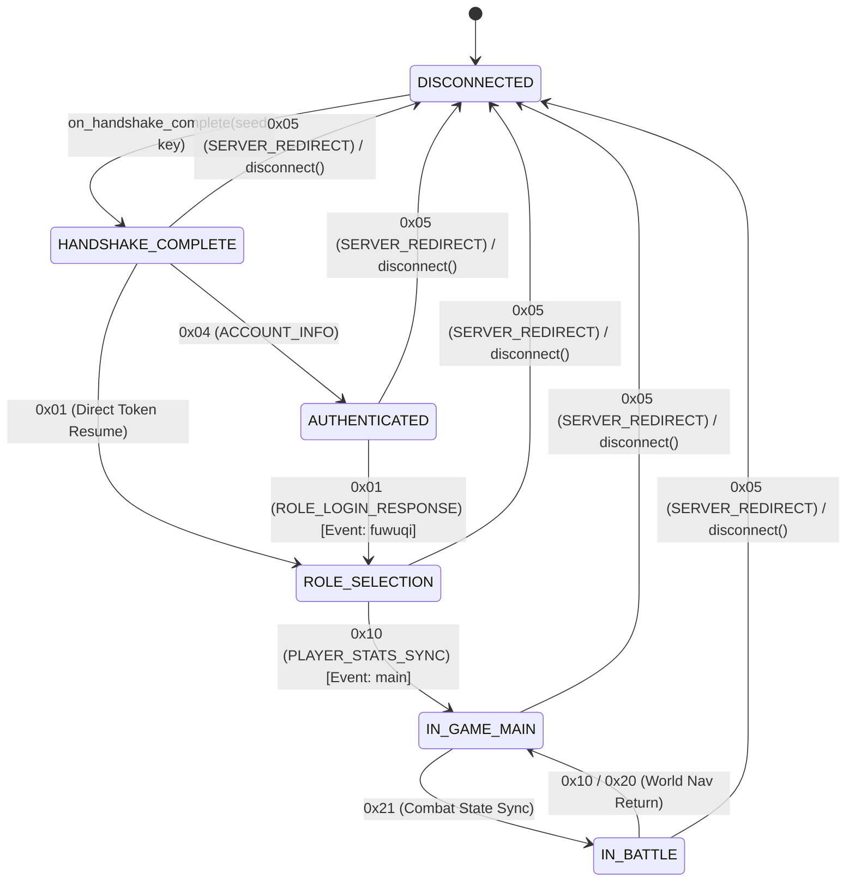

# ReturnSaiyan — P4.1 Protocol Contract Consistency & State Machine Hardening

## 1. Executive Summary & Audit Motivation

During the transition from **P3.1** (Packet Schema Reconciliation) to **P4** (Dynamic Packet Reconstruction & Offline Client State Initialization), an inconsistency audit identified documentation and implementation drift across several opcodes:
1. **Documentation Drift:** Section 6 of `docs/returnsaiyan_p4_dynamic_reconstruction.md` contained outdated P3 hypothetical names and schemas for opcodes `0x00`, `0x05`, `0x2C`, `0x2D`, `0x2E`, and `0x2F`, conflicting with both the verified disassembly in P3.1 and the Python codec.
2. **Silent Fallback Vulnerability:** The dynamic AST parser caught exceptions from nested decoders (such as truncated buffers or corrupt loop counts) and silently fell back to returning `parsed: True` with only the flat header fields, masking protocol corruptions.
3. **State Machine Preconditions:** `ClientStateMachine` previously permitted packets like `0x10` (Player Stats) to transition directly from `DISCONNECTED` or `HANDSHAKE_COMPLETE` to `IN_GAME_MAIN` without enforcing prerequisite authentication (`0x04`) and role selection (`0x01`).

**Mission P4.1** establishes an unyielding ground truth anchored directly in ARM64 machine instructions (`libaos_jogo.so`), builds a single canonical manifest, hardens the AST decoders against malformed data, and enforces strict state machine preconditions in preparation for **P5 — Offline End-to-End Mock Session**.

---

## 2. Exhaustive AArch64 Disassembly Audit (`libaos_jogo.so`)

The registration routines `aos::CProtocolManager::registrarTratadores` (`0x007ede44`..`0x007ee650`) and `aos::registrarChat` (`0x0075ef0c`) were disassembled to audit all lambda instances, vtable structures, and handler bodies.

```
CProtocolManager::registrarTratadores:
  0x007edf34: adrp x1, 0x14f0000; add x1, x1, 0xee0  ; vtable $_6 (0x014f0ee0)
  0x007edf44: mov  w2, #1                             ; opcode 0x01
  0x007ee238: adrp x1, 0x14f1000; add x1, x1, 0x260  ; vtable $_13 (0x014f1260)
  0x007ee248: mov  w2, #0x10                          ; opcode 0x10
```

### Audited Discrepant Opcodes

| Opcode | Lambda | Vtable Addr | Handler Addr | Ground Truth Structure & Semantics | Epistemic Status |
| :---: | :---: | :---: | :---: | :--- | :---: |
| `0x00` | `$_5` | `0x014f0e60` | `0x007f06c8` | **STATIC**: Calls `LeitorPacote::str` exactly once at `0x7f06fc`. Server system dialog/announcement notice. | VERIFIED |
| `0x05` | `$_8` | `0x014f0fe0` | `0x007f4de4` | **STATIC**: Calls `LeitorPacote::str` exactly once at `0x7f4e78`. Server redirection target host. | VERIFIED |
| `0x2C` | `$_28` | `0x014f1a50` | `0x0080203c` | **STATIC**: Exactly 8 fields: `[i64, u8, i16, i32, i32, str, i64, i16]`. Guild member summary profile. | VERIFIED |
| `0x2D` | `$_22` | `0x014f1750` | `0x007fed18` | **DYNAMIC**: Header `[u8, u8]` + loop reading `[i32, i32, i16, i32, u8, i16]` + tail `[str, i32]`. Special action notification. | PARTIAL |
| `0x2E` | `$_23` | `0x014f17d0` | `0x007ffc28` | **STATIC**: Exactly 6 fields: `[u8, str, str, str, str, str]`. Action status confirmation prompt. | VERIFIED |
| `0x2F` | `$_29` | `0x014f1ad0` | `0x00803800` | **DYNAMIC**: Trampoline `0x8037d0` -> handler `0x803800` (41 calls). Header `[u8, u8, str]` + mail item attachments array. | PARTIAL |

---

## 3. Canonical Manifest & Epistemic Boundaries

To prevent future documentation drift, `returnsaiyan_codec.py` defines `CANONICAL_OPCODE_MANIFEST` as the authoritative source of truth. All tests and documentation derive from this table.

### Business Name Epistemic Markings
- **`VERIFIED` Business Names:**
  - `0x01: ROLE_LOGIN_RESPONSE` (Proven by UI event string `"fuwuqi"` at `0x7f1cdc`).
  - `0x10: PLAYER_STATS_SYNC` (Proven by UI event string `"main"` at `0x7f68b0`).
  - `0x29: CHAT_MESSAGE_UPDATE` (Proven by registration in `aos::registrarChat` at `0x75ef0c`).
- **`INFERRED` Business Names:**
  - All remaining 24 opcodes are marked `name_certainty: "INFERRED"`. While their structural layout, field types, and handler addresses are mathematically verified from disassembly, their semantic names are derived from functional analysis rather than debug symbols.

### Structural Classification
- **18 STATIC Opcodes (`status: "VERIFIED"`):** `0x00, 0x04, 0x05, 0x07, 0x08, 0x0A, 0x12, 0x25, 0x26, 0x27, 0x28, 0x29, 0x2C, 0x2E, 0x30, 0x31, 0x33, 0x43`. Strict zero-trailing-bytes enforcement.
- **9 DYNAMIC Opcodes (`status: "PARTIAL"`):** `0x01, 0x10, 0x20, 0x21, 0x2A, 0x2B, 0x2D, 0x2F, 0x32`. Complex loop bodies, branch conditions, or switch-case jump tables.

---

## 4. AST Parser Hardening & Fallback Elimination

### Elimination of Silent Fallbacks
In previous revisions, if a dynamic AST decoder failed (e.g. truncated buffer, index out of range), the parser caught the exception and silently returned the flat header with `parsed: True`. This concealed network corruption and malformed packets.

In P4.1:
1. **Strict Rejection:** Any exception during AST decoding immediately produces:
   ```json
   {
     "parsed": false,
     "parse_status": "MALFORMED",
     "status": "MALFORMED",
     "error": "Malformed or truncated dynamic AST payload in opcode 0x...: ..."
   }
   ```
2. **Explicit Parsing States:**
   - `COMPLETE`: Payload parsed to the final byte with exactly 0 trailing bytes.
   - `PARTIAL`: Payload parsed valid AST structures, but has verified trailing bytes (e.g. unexercised optional blocks in dynamic opcodes).
   - `MALFORMED`: Packet truncated, schema mismatch, or unexpected trailing bytes in a STATIC packet.
3. **Count Bounds Checking:** Loop counters (`role_count`, `stage_count`, `waypoint_count`, `skill_count`) are checked against the remaining buffer capacity before entering loops, preventing memory exhaustion or hanging on malicious packets:
   ```python
   if role_count * 18 > reader.remaining():
       raise IndexError(f"role_count {role_count} exceeds remaining buffer capacity ({reader.remaining()} bytes)")
   ```

---

## 5. Hardened Client State Machine (`ClientStateMachine`)

The state machine implements formal preconditions and event side-effects derived from the game engine's UI subsystem (`aos::CUIManager`):



### Precondition Rules
1. **`DISCONNECTED`:** All incoming network packets are rejected with `ERR_NOT_CONNECTED`. Only `on_handshake_complete` can transition out of this state.
2. **`HANDSHAKE_COMPLETE`:** Only authentication (`0x04`) or direct token resume (`0x01`) permitted. Any attempt to jump directly to world entry (`0x10`) or gameplay actions (`0x20`, `0x2A`) fails with `ERR_PRECONDITION_FAILED`.
3. **`AUTHENTICATED`:** Awaiting role list (`0x01`). Direct world entry is blocked.
4. **`ROLE_SELECTION`:** Client renders role list. Only `0x10` transitions to `IN_GAME_MAIN`, firing UI event `(2, "main")`.
5. **`SERVER_REDIRECT` (`0x05`):** Captured from any connected state, stores `redirect_host`, rolls client back to `DISCONNECTED`, and returns `action: "RECONNECT_REQUIRED"`.
6. **`disconnect()`:** Clears all volatile session data (session tokens, roles, hero cache, player stats, inventory) and safely returns to `DISCONNECTED`.

---

## 6. Verification Suite & Test Results

The protocol model and state machine are validated by five test suites:

| Test Suite | Focus Area | Tests | Status |
| :--- | :--- | :---: | :---: |
| `test_codec_p2.py` | Key derivation, rolling XOR, TCP framing, reassembly | 6 | PASSED |
| `test_codec_p3.py` | Opcode uniqueness, cross-packet statelessness, malformed fuzzing | 7 | PASSED |
| `test_codec_p3_1.py` | 13 audited opcodes, schema reconciliation, manifest cross-check | 3 | PASSED |
| `test_codec_p4.py` | AST dynamic decoders (0x01, 0x10, 0x20, 0x21, 0x2A), basic state machine | 7 | PASSED |
| `test_codec_p4_1.py` | Manifest integrity, AST fallback rejection, bounds checks, hardened state machine | 9 | PASSED |
| **Total Test Suite** | **Comprehensive Regression & Protocol Validation** | **32** | **100% PASSED** |

In addition, all 30 tests in `tests/` (`test_stable.py`, `test_agent_orchestration.py`) pass without regressions (total 62 tests across project).

---

## 7. Preparation for P5 — Offline End-to-End Mock Session

With the protocol contract verified and the state machine hardened, **P5** will establish a fully simulated offline mock session:

### Scope for P5
1. **Mock Server Emulator:** An offline session runner capable of sending valid greeting frames, responding to client packets, simulating role login, and delivering character state.
2. **State Transition Traceability:** End-to-end recording of client transitions from initial TCP SYN emulation through authentication, character selection, inventory syncing, and dungeon entry.
3. **Boundary Disclaimer:** The mock session runs strictly offline against synthesized game vectors. It does not communicate with, emulate, or bypass live game security servers.
